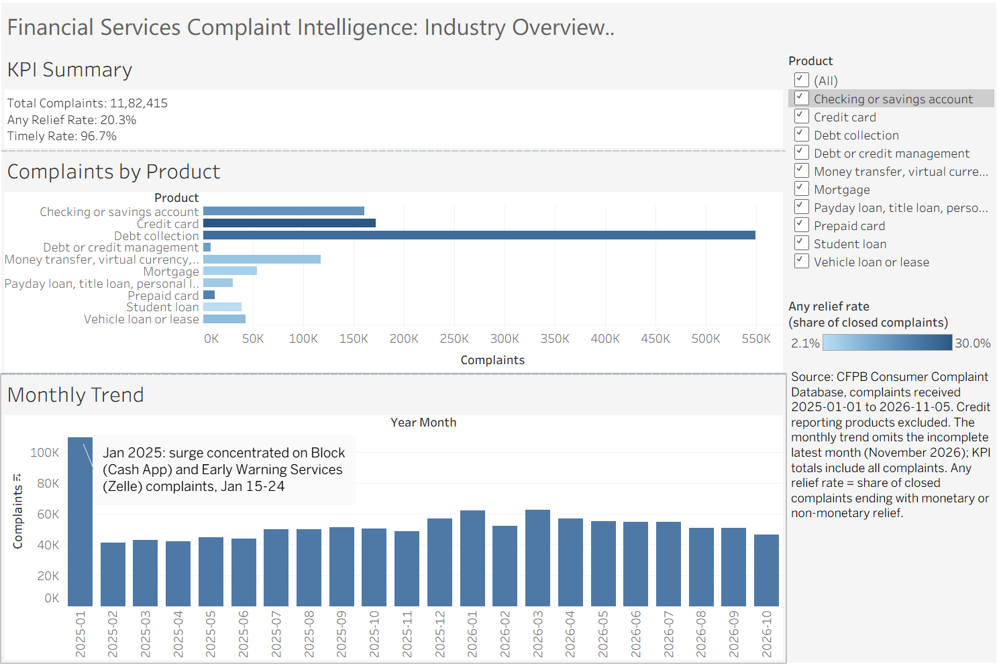
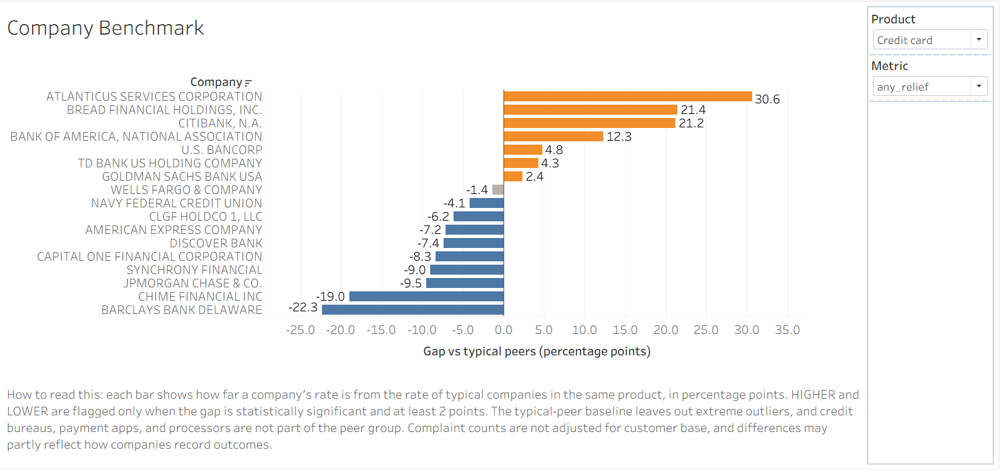
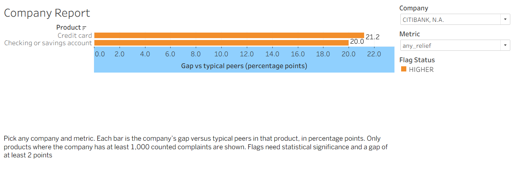

# Financial Services Complaint Intelligence

An end-to-end analysis of 1.18 million US consumer finance complaints (CFPB database, Jan 2025 to Nov 2026). It benchmarks companies **within each product**, with confidence intervals and significance tests, and ships a three-page Tableau dashboard that works for **any company** in the data.

**Built by:** _your name_  |  **Tools:** Python (pandas, SciPy), SQL (SQLite), Tableau Public  |  **Dashboard:** _paste your Tableau Public link_

<!-- After you upload dashboard/page1_industry_overview.png, delete this line's comment markers:

-->

## Business question

Across US consumer finance, what drives customer complaints, which companies and products resolve them well or badly, and which differences are large enough to be real rather than noise?

## Data

- **Source:** CFPB Consumer Complaint Database (public), complaints received 2025-01-01 to 2026-11-05.
- **Scope:** 1,182,415 complaints, 4,601 companies, 10 products. Credit reporting products were excluded to focus on banking and lending.
- **Cleaning:** no duplicates or missing key fields were found; consumer narratives were dropped to keep the file small. See `reports/data_quality_report.md`.

## Key findings

1. **Debt collection is 46% of all complaints** (548,900), so any industry-wide average is dominated by it. Company comparisons are therefore made within product.
2. **Volume is event-driven.** January 2025 had 109,916 complaints versus 41-45K in the following months. Two companies (Block and Early Warning Services) made up about 43% of that month, concentrated on Jan 15-24. Public reporting links this period to a CFPB order against Block on Jan 16, 2025 and to social-media campaigns encouraging complaints about Cash App and Zelle; the data alone cannot establish the cause.
3. **Monetary relief alone is a misleading outcome metric.** Of complaints with an outcome, about 20% end with some relief, but only 4.6% with monetary relief. Santander (vehicle loans) has about 2% monetary relief yet 33% any relief.
4. **Relief rates vary enormously between companies in the same product.** In credit cards, any-relief ranges from 7.7% (Barclays) to 59.8% (Atlanticus). In checking, from 0.9% (Goldman Sachs) to 43.9% (Huntington).
5. **Some lenders close almost everything without relief of any kind.** Westlake, Bridgecrest, Exeter (vehicle loans) and InComm (prepaid) have zero relief across thousands of complaints. This may reflect response practices as much as outcomes.
6. **Timeliness is near-universal among large banks (99%+); problems sit in a few servicers.** MOHELA (39.1% timely, student loans) accounts for about 72% of late student-loan responses. InComm (77.0%), Shellpoint (89.5%, mortgages), EdFinancial (94.6%) and Synchrony (97.2%) are the other flagged outliers.

## Dashboard

| Page | What it shows |
|---|---|
| Industry overview | KPIs, monthly trend (with the Jan 2025 surge annotated), complaints by product coloured by any-relief rate |
| Company benchmark | For a chosen product and metric, each company's gap versus typical peers, flagged HIGHER / LOWER only when significant |
| Company report | Pick any company and see its gap in every product |

<!-- After uploading the screenshots, add them here:


-->

## Metrics

| Metric | Definition |
|---|---|
| Any-relief rate | Closed with monetary or non-monetary relief, divided by closed complaints |
| Monetary-relief rate | Closed with monetary relief, divided by closed complaints |
| Timely-response rate | Responded on time, divided by all complaints |

"Closed" means closed with explanation, non-monetary relief, or monetary relief. Complaints "In progress" or marked "Untimely response" have no outcome yet and are excluded from the relief metrics. All rates are ratios of sums, never averages of percentages.

## Method

1. **Cleaning** (`src/clean.py`): snake_case columns, parsed dates, helper flags, SQLite load.
2. **SQL analysis** (`sql/`): trend with `LAG`, product shares, rankings with `RANK()`, company-versus-product benchmarks with CTEs and joins.
3. **Statistical benchmarking** (`src/stats_tests.py`), per product:
   - Peer pool: companies with at least 1,000 counted complaints, excluding credit bureaus, payment apps and processors (Block, Early Warning Services, PayPal, FIS, Finco) and a generic placeholder servicer.
   - Each company is compared with a baseline of *typical* companies (near the median rate, so one extreme company cannot distort everyone else's result).
   - Two-proportion z-test, Wilson 95% confidence intervals, Bonferroni correction for the number of companies tested, and a minimum 2-point gap before anything is flagged.
4. **Dashboard export** (`src/export_dashboard_data.py`): small CSVs for Tableau.

## Recommendations

1. **Benchmark within product and report confidence intervals**, using any-relief rather than monetary relief alone.
2. **Monitor concentration, not just volume.** A spike driven by two companies calls for a different response than broad deterioration.
3. **Investigate timeliness outliers first** (MOHELA, InComm, Shellpoint): they explain most of the late responses in their products.
4. **Validate response coding** at companies with zero relief before drawing conclusions about their customer outcomes.

## Limitations

- Complaints are self-reported and **not adjusted for customer base**; larger firms naturally receive more.
- Differences in relief rates may partly reflect how companies record outcomes.
- Statistical significance does not establish cause, and complaints are not a random sample of customers.
- The prepaid card peer pool has only three companies, so treat it as illustrative.
- The latest month is incomplete, and recent complaints may still change outcome.
- Narratives were dropped, so there is no text analysis.

## Repository structure

```
├── README.md
├── sql/              numbered, commented queries
├── src/              clean.py, stats_tests.py, export_dashboard_data.py, filter_raw.py, run_sql.py
├── reports/          data quality report and statistical results
├── dashboard/        screenshots and exported CSVs
└── requirements.txt
```

## How to run

```bash
pip install -r requirements.txt
# 1. Download the CSV from the CFPB Consumer Complaint Database and save it as data/raw/complaints.csv
python src/filter_raw.py                      # keeps 2025 onwards, drops credit reporting
python src/clean.py                           # clean and load into SQLite
python src/run_sql.py sql/01_overview.sql     # run any query
python src/stats_tests.py --all --robust --quiet
python src/stats_tests.py --company "WELLS FARGO" --metric any_relief --robust
python src/export_dashboard_data.py           # CSVs for Tableau
```

## Possible extensions

A complaint-outcome prediction model (triage), text analysis of narratives, and normalising by customer base where public data allows.

_Data: CFPB Consumer Complaint Database. This project is independent and not affiliated with any company named._